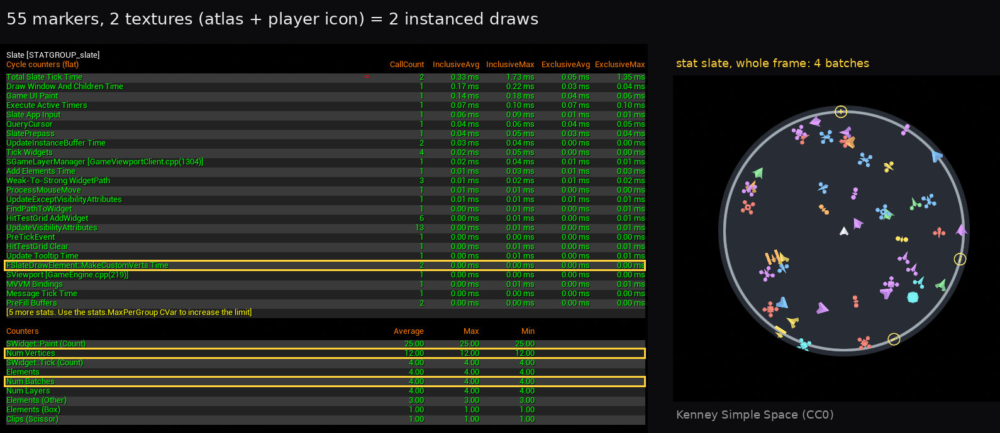

# SimpleMinimap

A radar minimap for Unreal Engine 5.8 whose markers are drawn as **one instanced Slate draw per
icon texture**, with an instance format that is safe on mobile GPUs.

> **This is a tech demo, not a product.** It shows one way to do it and is published as is
> (MIT). It is not generic code for every case: the packing, the limits and the feature set fit
> this demo. Read it, take what you need, and change it for your game.



*The demo scene from this plugin: 55 markers from one atlas plus the player's own texture. `stat slate`
shows 2 `MakeCustomVerts` calls, one per texture, and 4 batches for the whole frame: radar
background, 2 marker batches and one the frame has without the minimap.*

## Demo scene (in this plugin's Content)

Open `/SimpleMinimap/Demo/Lvl_SimpleMinimapDemo` and press Play. Fly around with the default pawn
(WASD and mouse); the radar turns with the view.

```
Content/
  Demo/
    Lvl_SimpleMinimapDemo          the level: three spawners, game mode override
    B_SimpleMinimapDemoGameMode    shows the widget, gives the player pawn a marker (T_PlayerShip)
    WBP_SimpleMinimapDemo          SimpleMinimapWidget in a 400x400 Size Box, top right
  Materials/
    M_SimpleMinimapMarker          markers: Custom nodes -> Shaders/Private/SimpleMinimapMarker.ush
    M_SimpleMinimapRadar           background: Custom node -> Shaders/Private/SimpleMinimapRadar.ush
  Icons/
    T_SimpleSpace_Sheet            Kenney atlas, 256x512
    Sprites/SPR_*                  14 Paper2D sprites cut from it (frames: T_SimpleSpace_Sheet.frames.json)
    T_PlayerShip                   single texture: the "one texture" case
```

The spawners (`SimpleMinimapDemoSpawner`, demo-only C++) are set in the level:
- 40 ships flying in circles;
- 12 static objects;
- 3 objectives clamped to the radar edge.

## What it shows

- **Batching.** 100 or 1000 markers cost one Slate batch (one draw call) per icon texture, not
  one widget each. A sprite atlas therefore means one draw for every icon in it.
- **Packing for one `float4`.** Slate instancing gives each instance exactly one `float4`.
  Position, rotation, colour and a sprite rect have to fit in it.
- **Mobile-friendly unpacking.** The data is unpacked in the vertex shader (always fp32); the
  pixel shader only gets small plain values, so mobile half precision is enough.

## How it is built

| Piece | File | Does |
|---|---|---|
| Marker component | `USimpleMinimapMarkerComponent` | put on an actor: icon (Texture2D or Paper2D sprite), palette index, rotate with actor, clamp to edge |
| World registry | `USimpleMinimapSubsystem` | world subsystem; components register on BeginPlay |
| Widget | `USimpleMinimapWidget` | UMG widget: every frame reads the markers, converts them to radar space around the owning player, packs them and uploads one instance buffer per icon texture |
| Batch | `SSimpleMinimapLayer` | Slate leaf widget: one quad + instance buffer, `FSlateDrawElement::MakeCustomVerts` |
| Packing | `SimpleMinimapPacking.h` / `Shaders/Private/SimpleMinimapMarker.ush` | the same layout in C++ and HLSL |
| Materials | `M_SimpleMinimapMarker`, `M_SimpleMinimapRadar` | Custom nodes that include the shader files |
| Shader path | `SimpleMinimapModule.cpp` | maps `Shaders/` to `/Plugin/SimpleMinimap` (module loads at PostConfigInit) |
| Demo | `Demo/` (C++ and content) | game mode, marker spawner, `Lvl_SimpleMinimapDemo` |

Frame flow:

```
actors with USimpleMinimapMarkerComponent
  -> USimpleMinimapWidget (game thread, every frame)
       world XY -> radar units around the player, rotate with the view
       group by icon texture, pack one float4 per marker
  -> SSimpleMinimapLayer per texture: one quad, N instances, one draw
  -> M_SimpleMinimapMarker
       vertex shader: unpack, place, rotate, atlas UV  (fp32)
       pixel shader:  sample atlas, tint, cut by the radar circle (half is fine)
```

## Packing

One marker = one `FVector4f`:

| Component | Content | Bits |
|---|---|---|
| X | position X, position Y (radar units, -1..1) | 12 + 12 |
| Y | angle (clockwise), palette index | 16 + 8 |
| Z | sprite rect origin U, V (atlas pixels) | 12 + 12 |
| W | sprite rect width, height (atlas pixels) | 12 + 12 |

Each component is a **whole number below 2^24**, which a float stores exactly. It is built with
integer maths on the CPU and taken apart with `floor` and multiplications in the vertex shader. No
bits are reinterpreted, so there are no NaN or denormal payloads and no `asuint`.

Why not the usual bit packing (`asuint` and shifts)? It works on PC and consoles, where the whole
path is 32-bit. On mobile, Unreal runs material code in the pixel shader in half precision
(`MaterialFloat = half`, `mediump`): 32 packed bits do not survive that, and even arithmetic
packing loses precision there. So the rule here is: **packed data never goes past the vertex
shader.** The vertex shader passes plain values to the pixel shader through Customized UVs:

| Customized UV | Value |
|---|---|
| UV5 | atlas UV of the corner |
| UV6 | corner position in radar units (for the circle mask) |
| UV7.x | palette index |

A single texture and a sprite from an atlas use the same layout: for a texture, the rect is the
whole texture.

### Limits that follow from it

- position step 2/4095 of the radar radius (~0.1 px on a 512 px radar);
- angle step ~0.0055 degrees;
- 8 palette colours in the material (the format has room for 256);
- atlases and sprites up to 4095 px;
- one icon size for the whole widget (no per-marker scale: there is no room left for it);
- one batch per icon texture: put all icons in one atlas for a single draw.

Need more per marker (scale, alpha, a second colour)? Change both `SimpleMinimapPacking.h` and
`SimpleMinimapMarker.ush`. For example, drop a position bit or two, or move the palette index into
spare rect bits.

## Using it

1. Enable the plugin (Paper2D too if you use sprites).
2. Add a `SimpleMinimapWidget` to any Widget Blueprint, inside a square Size Box. Set:
   - `Background` brush: `M_SimpleMinimapRadar` (or anything else);
   - `Marker Material`: `M_SimpleMinimapMarker`;
   - `Range` (world units to the edge), `Rotate With View`, `Icon Size`, `Palette`.
3. Add `SimpleMinimapMarkerComponent` to actors and pick an `Icon` and `Color Index`.

All of this is setup in Blueprint; there is no logic to write.

The [demo scene](#demo-scene-in-this-plugins-content) is a working example of this setup.

## Measured

`stat slate` in the demo (the picture at the top; Linux, Vulkan, Development Editor build in
`-game`, 1920x1080, one run):

| | |
|---|---|
| markers | 55 from the atlas + 1 player texture |
| `FSlateDrawElement::MakeCustomVerts` calls | 2 (one per texture) |
| Num Batches, whole frame | 4: radar background, 2 marker batches, 1 that is there without the minimap |
| Num Vertices, whole frame | 12 (3 quads; markers are instances) |

Not measured: the cost of 1000 moving markers, any device. The batching comparison against one
widget per marker (100 and 1000 markers) is in the write-up this demo comes from.

## Not done, on purpose

What this demo does not do, and what you would add yourself:

- **Map shapes.** Only a round radar around the player: no full world map, scrolling terrain
  texture, square mask or zoom UI.
- **Interaction.** No clicks or tooltips on markers (Slate has no per-instance hit test; do it on
  the CPU from the same positions).
- **Widget transforms.** The widget's render transform is not applied to the markers (the
  material places them in window pixels).
- **Fewer uploads.** Every marker is updated every frame. Add dirty checks or a lower update rate
  if your markers are mostly static.
- **Draw order.** No sorting between markers; batches draw in the order their texture first
  appeared.
- **Platforms.** It is not tested on a mobile device. The mobile reasoning comes from the engine's
  shader code and an fp16 simulation on PC (see the packing section).

## Credits

- Icons: [Kenney](https://kenney.nl) "Simple Space", CC0.
- Code: MIT, see `LICENSE`.
